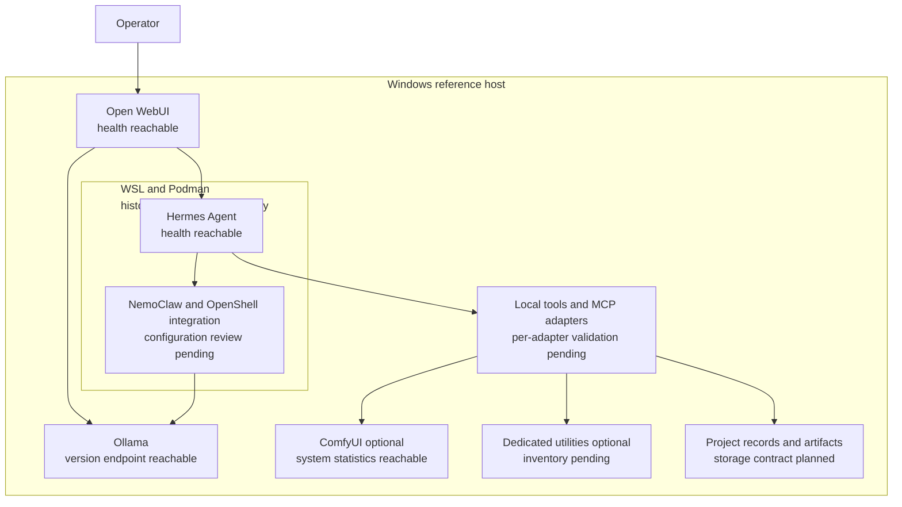

# Local AI Workstation architecture

The workstation combines a Windows host, local model serving, an agent runtime, local tools, and optional media workflows. This is the logical architecture for the reference build. It documents the intended boundaries and the historically observed integration; it is not a complete deployment specification.

The [reference status](REFERENCE-STATUS.md) distinguishes current endpoint observations from earlier local results and work still to validate.

## Components and boundaries

| Component | Role | Evidence status |
|---|---|---|
| Windows host | Runs the workstation, exposes local storage, and provides the operator's desktop | Hardware and operating system inspected on October 31, 2026 |
| Open WebUI | Local interface to model and agent services | Health endpoint reached; configured integrations require separate validation |
| Ollama | Serves the selected local language model | Version endpoint reached; inference and current model residency were not tested in this baseline |
| Hermes Agent | Executes bounded tasks using a language model and tools | Health endpoint reached; prior project notes describe the agent runtime inside WSL and Podman |
| NemoClaw and OpenShell integration | Connects the historical Hermes deployment to its local inference and execution environment | Historical deployment detail; exact current configuration and boundaries remain to inventory |
| Local tools and MCP adapters | Connect approved workflows to files and services through explicit interfaces | Availability and permissions must be verified per adapter and client |
| ComfyUI | Optional local image, video, and audio workflow execution | System statistics endpoint reached and two CUDA devices enumerated |
| Dedicated utilities | Optional transcription, speech, OCR, embedding, and media inspection functions | Inventory, dependencies, and individual task validation remain to publish |
| Project records and outputs | Store task evidence, project decisions, and generated artifacts | A repository-wide storage and retrieval contract remains to define |

## Logical architecture

The diagram is a proposed documentation model based on the historical stack. A service being reachable does not verify every connecting arrow. Model calls, tool execution, storage mappings, and client integrations each need an end-to-end test.

## Model and GPU operation

The design starts with one general-purpose local Qwen model for research, writing, and agent work. The exact model artifact, digest, quantization, context setting, and license must be recorded before a reproducible release. Additional general models should be introduced only when a measured task benefit justifies their memory and loading costs.

The reference host has two GPUs. Device enumeration does not establish automatic memory pooling, workload placement, or effective use of both devices. Those behaviors depend on the selected runtime and workflow.

GPU coordination is a planned requirement. The proposed operating sequence is to save agent work, release the general model's GPU allocation when necessary, run a media workload, verify its result, and restore the general model for review. Automatic scheduling, safe concurrent execution, memory-pressure recovery, and restart recovery have not been established by the current baseline.

## Paths and configuration

Deployment documentation should use configurable locations rather than an author's account name or fixed drive letters. The following names describe proposed configuration concepts; they are not an implemented configuration API.

| Proposed setting | Contents |
|---|---|
| `WORKSTATION_ROOT` | Integration code, launchers, and deployment configuration |
| `MODELS_ROOT` | Model artifacts acquired separately under their applicable licenses |
| `PROJECTS_ROOT` | Operator-owned project inputs and records |
| `OUTPUTS_ROOT` | Generated artifacts and verification reports |
| `STATE_ROOT` | Runtime state, local databases, and private operational logs |

Host-to-container mappings must be explicit. A path printed by an agent is not proof that a file exists on the host; artifact verification must occur at the intended host destination.

## Interface and trust requirements

The intended core uses local inference. Offline operation and the absence of unintended network traffic remain acceptance tests, rather than established properties of the entire stack. Optional online retrieval or external publishing must be identified separately from core execution.

Each tool adapter needs a documented client, permissions, endpoint, expected result, failure behavior, and independent verification procedure. Registration in one client does not establish operation in another. No general ChatGPT, browser automation, or desktop automation compatibility claim follows from the health checks in this repository.

Project records need an authoritative location, retrieval rules, provenance, and conflict handling. Fresh-session tests must show that the appropriate record is retrieved and used. Filesystem access alone does not demonstrate durable memory or independent reproduction.

Repository content is a curated distribution of documentation and future original integration code. Model weights, credentials, private records, runtime databases, personal media, and operational logs remain outside the publication package.
